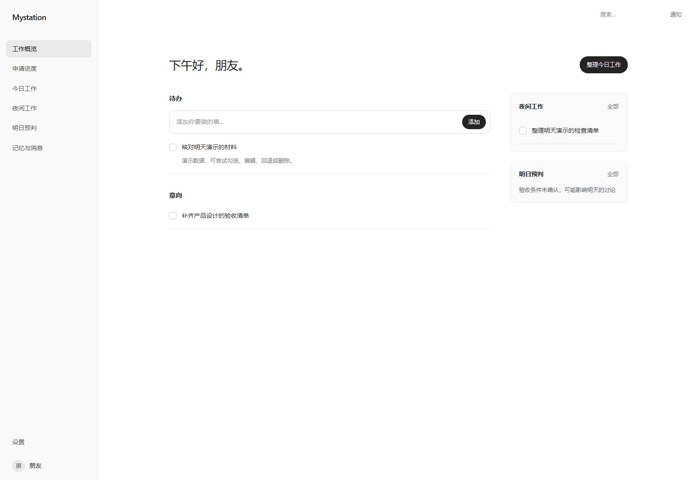
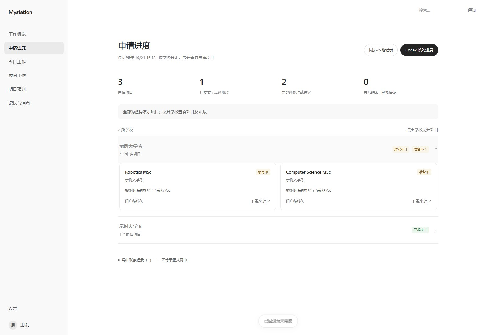

# Mystation — a local personal workspace

English | [简体中文](README.zh-CN.md)

**A local personal workspace powered by Codex, with optional Feishu and application tracking.** A clean, editable web UI for todos, inferred intentions, recommendations, searchable memories/messages, and school-grouped applications. Formerly Codex × Feishu Workstation; the repository URL stays the same.

[Setup and Codex configuration](docs/SETUP.md) · [Application tracking and Gmail snapshots](docs/APPLICATIONS.md) · [Optional Feishu](docs/FEISHU.md)



## Try the UI immediately

Python **3.11+**. Linux/macOS use system timezone data; native Windows also needs `python -m pip install -r requirements.txt` (`tzdata`). No frontend build, API keys, or accounts are required for the demo.

```bash
git clone https://github.com/zxyllebron/codex-feishu-workstation.git
cd codex-feishu-workstation
python3 server.py --demo
```

Open **http://127.0.0.1:8765/**. If occupied, add `--port 8766`. On Windows use `python` instead of `python3`. The demo includes fictional applications grouped by school; it never connects to accounts, reads your Codex history, or invokes a model. Edits disappear when the demo exits. Stop with Ctrl+C.

## Connect your own accounts

Install and sign in to **Codex CLI**. Feishu is optional: set `feishu_enabled` to `false` to use Codex alone. For application tracking, start from [config.applications.example.json](config.applications.example.json) as your ignored `config.json`, and follow the [snapshot guide](docs/APPLICATIONS.md). Gmail access is not bundled: your own authorized collector must provide the snapshots.

```bash
npm install -g @openai/codex
codex login

python3 manage.py init
# Edit config.json: display name, timezone, paths, optional Codex model.
python3 manage.py doctor
python3 server.py
```

To enable Feishu, install the official CLI with `npx @larksuite/cli@latest install`, then run `python3 manage.py feishu-setup` and `python3 manage.py feishu-login`. Complete your own tenant setup and personal read-only permission grant. See the [Feishu guide](docs/FEISHU.md). Every `manage.py feishu*` command uses the same isolated credential directory as the web service.

## What it does

- **Your todos stay yours.** Only manually entered tasks become todos. Codex proposes at most three intentions in a separate section.
- **Edit and reopen.** Right-click a manual todo to edit it. Completed todos can also be returned to unfinished; editing preserves completion and its original timestamp.
- **24-hour completion retention.** Completed work stays on the home page for a full 24 hours, across midnight and restarts, then appears in Memories & Messages → Completed. Reopening and completing again starts a new timer.
- **School-grouped applications.** Optional application evidence from local notes, Codex history and imported Gmail/portal snapshots. Expand a school to view its programs, stages, next actions and cited sources. Faculty contacts are separate from formal applications; historical evidence is distinct from portal verification.
- **17:00 planning.** Night recommendations (0–3) and forecasts (0–2) update together at 17:00, or when you explicitly click a planning button. Morning summaries at 09:00 update intentions only. Times can be changed or paused.
- **Manual execution.** A night recommendation contains its theme, content, and copyable prompt. You choose whether to paste it into Codex. Copying never marks it complete; checkboxes do. No automatic night execution or task queue.
- **Separate deletion and completion.** Todos, intentions, recommendations, and forecasts support right-click deletion. Completed work has separate lazy-loaded categories and a confirmed permanent-delete action.
- **Read-only ingestion.** Personal Feishu OAuth, cross-chat search, paginated bulk message retrieval, and thread/reply identifiers. Refreshes today's visible messages every 10 minutes. A bot alone does not grant access to your personal conversations.
- **Five-day window, long-term files.** The UI shows today plus the previous four dates. Older collected records remain in local SQLite and daily Markdown archives. A “related to me” filter selects mentions, DMs, your messages, and participated threads.
- **Reusable UI and backend.** Vanilla HTML/CSS/JavaScript, Python and SQLite; Windows adds timezone data only. Change CSS tokens, components, prompt schemas, or source adapters directly. No hosted dashboard subscription.



## Configuration and platform scope

`config.example.json` documents the non-secret settings. Copy/init it as `config.json`; credentials belong to the official CLIs, never this file. Relative paths resolve next to the selected configuration file. Set `WORKSTATION_CONFIG` to use another file. [Full configuration and Codex guide](docs/SETUP.md).

The interface is Chinese; the introduction and setup guides are available in English and Chinese. Native Windows includes UTF-8, timezone, SQLite connection-lifecycle and process-cancellation fixes. Automated checks cover Linux, Windows and macOS; they use synthetic data and mocked accounts, not real Gmail/Feishu authorizations. Run the foreground server on each platform; Linux user-service installation is optional:

```bash
python3 manage.py install-service
# Run the two systemctl commands printed by the helper.
```

The app runs only on `127.0.0.1`; no public hosting or GitHub Pages backend is provided. Your computer and service must remain on for synchronization and schedules. No Codex desktop heartbeat is installed automatically.

## Data and privacy

Local files stay under the configured data directory. When you request or schedule analysis, selected enabled-source evidence is sent through your authenticated Codex model service. Gmail and portal snapshots require your own authorization and collection; no connector grant or background desktop automation is included. **Local storage does not mean offline inference.** Read [data boundaries and limitations](SECURITY.md).

This repository contains source, synthetic test/demo data, and documentation only. It does not contain the author's messages, local databases, private Feishu account/conversation identifiers, tokens, screenshots of private work, or Codex authentication files. Never publish your own `data/`, `config.json`, CLI credential stores, or `~/.codex`.

See the [release privacy audit](docs/RELEASE-PRIVACY.md) for the included/excluded files and public attribution boundary.

## Development

```bash
python3 -m unittest discover -s tests -q
node tests/test_browser_collector.mjs
node --check static/app.js
python3 scripts/smoke_demo.py
python3 scripts/audit_release.py
```

See [architecture, customization and API](docs/ARCHITECTURE.md). Contributions should keep personal ingestion read-only and night work user-controlled. [MIT license](LICENSE). This independent project is not affiliated with or endorsed by OpenAI or Feishu; the UI uses system fonts and original HTML/CSS, without proprietary logos or font files.
