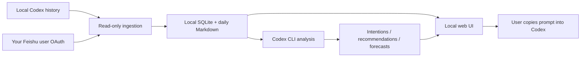

# Architecture and customization / 架构与定制

## Modules

| File | Responsibility / 职责 |
|---|---|
| `server.py` | Loopback HTTP API, static files, schedule loop / HTTP 接口与调度 |
| `config.py` | Portable configuration, explicit CLI/account paths / 可移植配置 |
| `storage.py` | SQLite, manual completion, deletion markers, completed categories / 状态持久化 |
| `sources.py` | Read-only Codex history, collection coordination / Codex 历史与同步协调 |
| `feishu.py` | Account checks, authorization flow, pagination/worker state / 飞书授权与进度 |
| `feishu_api.py` | Four-endpoint personal read adapter, bulk verification, exports / 个人 API 与导出 |
| `engine.py` | Codex context/schema, scoped analysis, report generation / 意向、规划与报告 |
| `archives.py` | Daily Markdown snapshots and download / 日归档 |
| `static/` | Original reusable HTML/CSS/JavaScript UI / 可直接复用的网页 UI |
| `manage.py` | Setup, diagnostics, isolated CLI wrapper, Linux service generator / 安装助手 |
| `demo.py` | Temporary fictional UI fixture / 隔离演示 |

## Data flow

Manual todos are separate from inferred intentions. Planning is descriptive; there is no executable night queue. Analysis scopes are `intentions`, `planning` and `all`. Morning scheduling uses `intentions`; 17:00 scheduling uses `planning`; explicit overview clicks can use `all`. Idempotent per-date schedule slots prevent duplicate reports. Late planning is not automatically rerun.

`records` keeps latest source records and `record_snapshots` keeps daily versions. `tasks` stores manual todos and intentions; `planning_items` stores user-visible recommendations and forecasts with stable normalized-title IDs. Soft-deletion markers prevent the same item being regenerated. `purged_items` prevents confirmed permanently deleted IDs being reimported. Independent old backups are not rewritten by deletion.

## Customize the UI

- Change color, font and spacing tokens in `static/style.css` (`:root`). System fonts are used; no proprietary assets are bundled.
- Navigation, row rendering, completed views and copy prompts live in `static/app.js`. Keep `data-work-*` attributes if retaining right-click menus.
- `static/index.html` is the shell; API state fills it. Reuse `static/` with your own backend by matching the response contracts.
- Change planning schemas and filtering in `engine.py`. Preserve evidence references, manual todo ownership, and the distinction between recommendation, execution and completion.
- The current scope is Codex + Feishu. No other software/AI adapters are installed.

## API overview

Mutations require loopback Host, same-origin checks and `X-Workstation-Key` from `/api/state` (`X-Workworld-Key` is a legacy compatibility alias). The key is process-local and not an internet-facing login system.

| Method | Path | Purpose |
|---|---|---|
| GET | `/api/health`, `/api/state` | Service/state |
| GET | `/api/records` | Five-day records, `kind`, `related`, `query`, pagination |
| GET | `/api/archives`, `/api/archive?day=YYYY-MM-DD` | Markdown index/download |
| GET | `/api/completed` | Lazy category index; then `category=work|night|date` and optional `day` |
| POST | `/api/task/create`, `/api/task` | Manual todo and completion edits |
| POST | `/api/planning` | Night recommendation checkbox `{id,status}` |
| POST | `/api/item/delete` | Delete `{kind:task|night|risk,id}` without completing |
| POST | `/api/completed/delete` | Confirmed permanent deletion of an eligible completed item |
| POST | `/api/analyze` | Explicit scoped generation `{scope:all|intentions|planning}` |
| POST | `/api/sync` | Explicit refresh |
| POST | `/api/feishu/connect`, `/api/feishu/crawl`, `/api/feishu/stop` | Personal connection and collection controls |
| GET | `/api/feishu/export` | JSONL, Markdown or brief export |
| POST | `/api/settings` | User preferences |
| POST | `/api/run` | Returns 410; automatic night execution removed |

## Release checks

Run the documented Python/Node tests and `scripts/audit_release.py`. Tests use synthetic fixtures and mock network/model calls; they do not validate another tenant's authorization. Keep private data out of commits and screenshots. Use `git archive` to create release bundles from tracked source after review.

中文说明：这套框架将数据读取、持久化、模型整理和 UI 分开。复用时优先修改样式变量和页面组件，保持手填待办不受模型改写，推荐不自动执行，删除与完成分开，输入消息只作为材料。模型整理需要联网；本地数据库格式和飞书权限变化需如实报告，不把测试替代为真实账号的验收。
